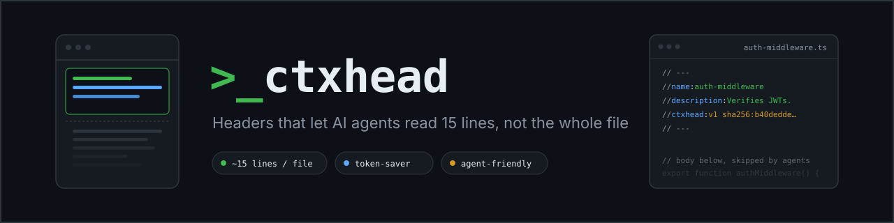

<p align="center"></p>

# ctxhead

An npm CLI that puts a short frontmatter header at the top of each source file, so AI coding
agents read ~15 lines instead of whole files. Staleness is detected with a per-file body hash
plus one repository-level `lastRunSha`.

ctxhead installs a skill, a command, and a rules block into the
agents you already use: Claude Code, Codex, Gemini CLI, and Antigravity.

Requires Node 22+ and git.

## Quick start

```sh
npm install -g ctxhead          # or run any command with `npx ctxhead`

ctxhead install --project --tools claude   # skill, command and rules block for your agent
ctxhead init                    # creates .ctxignore and .ctxhead.json
ctxhead add src                 # choose what gets headers
ctxhead enable                  # allow header writes
ctxhead stale                   # see what needs a header, with a token estimate
```

<p align="center"></p>

Then ask your agent to run the `ctxhead` skill (or the `/ctxhead` command). The agent writes
each description; the CLI validates and stamps it.

## Onboarding commands

| Command                      | What it does                                                                                                           |
| ---------------------------- | ---------------------------------------------------------------------------------------------------------------------- |
| `ctxhead init`               | Creates `.ctxignore` (default exclusions) and `.ctxhead.json` (empty include list, disabled). Existing files are kept. |
| `ctxhead add <path...>`      | Adds files or folders (relative to the repo root) to the include list.                                                 |
| `ctxhead remove <path...>`   | Removes them from the include list.                                                                                    |
| `ctxhead enable` / `disable` | Allows or blocks header writes in this repository.                                                                     |
| `ctxhead status`             | Shows enabled state, include list, files in scope, and missing/stale/invalid counts.                                   |

A file is in scope when it is under an included path, not matched by `.ctxignore` or
`.gitignore`, and has a supported line-comment syntax. See [docs/header-format.md](docs/header-format.md).

## Agent commands

| Command                                                  | What it does                                                                                         |
| -------------------------------------------------------- | ---------------------------------------------------------------------------------------------------- |
| `ctxhead stale [--json]`                                 | Lists files whose header is missing, invalid, or stale. Records `lastRunSha` when nothing is listed. |
| `ctxhead write <file> [--name <n>] --description <text>` | Validates and writes a header. Exit 2 and `rule <id>:` lines when the input breaks a rule.           |
| `ctxhead check`                                          | Read-only: exit 1 if any in-scope file is missing, invalid, or stale. Use it in CI.                  |

## Installing into agents

```sh
ctxhead install --global                         # pick agents interactively, user-level
ctxhead install --project --tools claude,codex   # repository-level, named agents
ctxhead update --project                         # regenerate after upgrading ctxhead
ctxhead uninstall --project                      # remove everything ctxhead wrote
```

Exactly one of `--global` or `--project` is required. Without `--tools`, an interactive picker
preselects detected agents; in a non-interactive shell `--tools` is required.

| Agent       | `--project` writes                                                                                              | `--global` writes                                                                                   |
| ----------- | --------------------------------------------------------------------------------------------------------------- | --------------------------------------------------------------------------------------------------- |
| Claude Code | `.claude/skills/ctxhead/SKILL.md`, `.claude/commands/ctxhead.md`, `AGENTS.md` block, `CLAUDE.md` import block   | `~/.claude/skills/ctxhead/SKILL.md`, `~/.claude/commands/ctxhead.md`, `~/.claude/CLAUDE.md` block   |
| Codex       | `.agents/skills/ctxhead/SKILL.md`, `AGENTS.md` block                                                            | `~/.agents/skills/ctxhead/SKILL.md`, `~/.codex/AGENTS.md` block                                     |
| Gemini CLI  | `.gemini/skills/ctxhead/SKILL.md`, `.gemini/commands/ctxhead.toml`, `AGENTS.md` block, `GEMINI.md` import block | `~/.gemini/skills/ctxhead/SKILL.md`, `~/.gemini/commands/ctxhead.toml`, `~/.gemini/GEMINI.md` block |
| Antigravity | `.agents/skills/ctxhead/SKILL.md`, `.agents/workflows/ctxhead.md`, `AGENTS.md` block                            | `~/.gemini/config/skills/ctxhead/SKILL.md`, `~/.gemini/AGENTS.md` block                             |

Codex has no custom-command install, and Antigravity has no global command (no documented path).
Every installed file carries a `ctxhead-managed` marker; ctxhead never overwrites or deletes an
unmarked file, and edits shared files (`AGENTS.md` and friends) only between
`<!-- ctxhead:start -->` and `<!-- ctxhead:end -->`.

## Exit codes

`0` success, `1` failure (or `check` found problems), `2` validation rejected by `write`.

## License

ctxhead is licensed under the Apache License, Version 2.0. See [LICENSE](LICENSE) for the full text, and [TRADEMARKS.md](TRADEMARKS.md) for the trademark policy covering the name "ctxhead".

Files that ctxhead generates in your repository belong to you. This includes the frontmatter headers, `.ctxhead.json`, `.ctxignore`, and the installed skill, command, and rules files.
